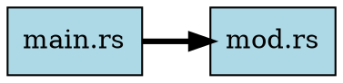
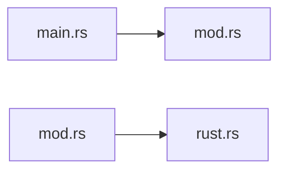

# Code intelligence

`ctx index` parses your codebase into a local index of symbols and relationships. The commands on this page query that index.

## Overview

With the index you can:
- find functions, classes, structs, enums, traits and interfaces by name or meaning
- follow calls, inheritance, trait and interface implementations, and imports
- list the callers and dependencies of a symbol
- see which symbols a change to a symbol could affect
- search with natural-language queries, using embeddings
- measure coupling and find near-duplicate functions
- export dependency graphs as DOT, Mermaid or JSON

## Building the index

### Basic indexing

```bash
ctx index
```

This creates `.ctx/codebase.sqlite`, which holds:
- symbols: functions, classes, interfaces, structs, enums, traits
- edges: calls, extends, implements, uses
- files: metadata, imports, and compressed source code
- a full-text index over symbol names, signatures and documentation

Example output:
```
Indexing codebase...
Indexed 20 files (46 skipped, 0 failed)
Extracted 548 symbols, 2664 edges in 890ms

Codebase statistics:
  Files:     20
  Symbols:   548
  Functions: 446
  Structs:   35
  Enums:     11
  Traits:    3
  Edges:     2664
```

### Incremental updates

ctx re-parses only files whose content hash changed:

```bash
ctx index  # Only processes modified files
```

On the 2,000-file perf fixture an incremental index with one changed file has a 300 ms budget.

After upgrading ctx to a version with changed parser behavior, run `ctx index
--force` once. Content hashes can't tell that unchanged files need to be parsed
again, so an older index lacks newly recognized relationships, such as Rust
function-item `uses` edges. An index with an older schema version reports a
mismatch until you rebuild it.

### Force a full reindex

After you change `.contextignore`, or to start clean:

```bash
ctx index --force
```

This deletes the existing database and rebuilds it.

### Watch mode

Reindex when files change:

```bash
ctx index --watch
```

Output:
```
Performing initial index...
Initial index complete: 20 files, 548 symbols

Watching for changes... (press Ctrl+C to stop)
.  # dots indicate files being reindexed
```

Press `Ctrl+C` to stop.

### Verbose output

Print each file as it is indexed:

```bash
ctx index --verbose
```

Output:
```
Indexing: src/main.rs
Indexing: src/lib.rs
Indexing: src/parser/mod.rs
...
```

### Filtering what gets indexed

`ctx index` respects `.gitignore`, `.contextignore`, and the built-in ignore patterns. To change what it indexes:

```bash
# Ignore additional patterns
ctx index -i "tests/" -i "*.generated.ts"

# Only index specific patterns
ctx index -p "src/**/*.rs" -p "lib/"

# Positional paths scope the same way (a bare directory means everything under it)
ctx index src

# Disable gitignore (index gitignored files)
ctx index --no-gitignore

# Disable built-in ignores (node_modules, target, etc.)
ctx index --no-default-ignores
```

An explicit scope that matches no files is an error: `ctx index` exits 2 and leaves the existing index untouched. The banner shows the effective scope (`Indexing codebase (scoped to: src)...`).

The filtering options work the same way in watch mode:

```bash
# Watch only specific directories
ctx index --watch -p "src/**/*.ts"

# Watch but ignore test files
ctx index --watch -i "**/*.test.ts"
```

### Index options

```
ctx index [PATTERNS]... [OPTIONS]

Options:
  -w, --watch                    Watch for changes and reindex automatically
  -v, --verbose                  Show verbose output (files being indexed)
      --force                    Force full reindex (clears existing database)
      --no-gitignore             Disable .gitignore pattern matching
      --no-default-ignores       Disable built-in ignore patterns
  -i, --ignore <PATTERN>         Additional ignore patterns (can be repeated)
  -p, --pattern <PATTERN>        Include patterns - only index matching files (can be repeated)
      --serial                   Disable parallel indexing (parallel is the default)
```

## Searching

### Keyword search

```bash
ctx search "handleRequest"
```

Results combine three kinds of match, in this order:
1. exact name matches
2. names that start with the query
3. FTS5 keyword matches in names, signatures and docs (labelled `[semantic]` in the output)

Example output:
```
Search results for 'parse' (13 matches):
---------------------------------------------------------------------------
SYMBOL                                   KIND     SCORE  FILE
---------------------------------------------------------------------------
parse                                    function 100%   src/parser/typescript.rs:261
  [exact] pub fn parse(&mut self, file_path: &str, source: &str, variant: JsV...
  # Parse a TypeScript/JavaScript source file.

parse                                    method   100%   src/parser/mod.rs:86
  [exact] pub fn parse(&mut self, path: &Path, source: &str) -> Option<ParseR...
  # Parse a source file and extract symbols/edges.

test_parse_struct                        function 43%    src/parser/rust.rs:561
  [semantic] fn test_parse_struct()
```

### Multi-word keyword search

Keyword search also accepts several words:

```bash
ctx search "error handling"     # Matches handleError, ErrorHandler, etc.
ctx search "auth token"         # Matches authentication-related symbols
ctx search "parse config"       # Finds configuration parsers
```

### Semantic search

To search by meaning rather than by words, generate embeddings first:

```bash
# Generate embeddings first (one-time)
ctx embed

# Then search with natural language
ctx semantic "functions that handle user authentication"
ctx semantic "database connection management"
ctx semantic "error recovery and retry logic"
```

For example, "authentication functions" can find `login`, `verify_token` and `check_credentials`, although none contains the word "authentication".

### Search options

```bash
ctx search "query" --limit 10       # Limit results
ctx search "query" --output json    # JSON output

ctx semantic "query" --limit 20            # Semantic search with limit
ctx semantic "query" --output json         # JSON output
ctx semantic "query" --provider ollama     # Use an Ollama embedding model
```

## Generating embeddings

### Basic embedding generation

Choose a backend with `--provider <local|openai|ollama>` (default `local`):

```bash
# Local embeddings (fastembed, no API key; ~90 MB model on first run)
ctx embed

# Ollama embeddings (offline; start `ollama serve` and pull a model first)
ollama pull nomic-embed-text
ctx embed --provider ollama
OLLAMA_EMBED_MODEL=qwen3-embedding:8b ctx embed --provider ollama

# OpenAI embeddings (requires OPENAI_API_KEY)
export OPENAI_API_KEY=sk-...
ctx embed --provider openai        # `--openai` is a deprecated alias
```

ctx stores the embeddings in the index. Later runs embed only symbols that don't have one yet.

Each provider and model produces vectors in a different space. Semantic commands refuse to rank against a corpus from another provider, model or dimension and exit 2. To switch, rebuild with `ctx embed --force --provider <provider>`: `--force` clears the stored corpus and the vector-search cache first. It also applies to the initial build of `ctx embed --watch`.

### Embedding providers

| Provider | Model | Dimensions | Requirements |
|----------|-------|------------|--------------|
| Local (default) | all-MiniLM-L6-v2 | 384 | ~90MB download on first run |
| OpenAI | text-embedding-3-small | 1536 | `OPENAI_API_KEY` env var |
| Ollama | `nomic-embed-text` (default) | probed from model | local/remote Ollama server (`OLLAMA_HOST`, default `http://localhost:11434`) |

Select one with `--provider <local|openai|ollama>`. See [Configuration](./configuration.md#embedding-providers) for models, hosts, and `.ctx/config.toml` defaults.

### Embedding options

```bash
ctx embed                        # Local model (default)
ctx embed --provider openai      # Use OpenAI API (`--openai` is a deprecated alias)
ctx embed --provider ollama      # Use a local/remote Ollama server
ctx embed --serial               # Compute single-threaded (parallel is the default)
ctx embed --verbose              # Show progress
ctx embed --force                # Clear the corpus and re-embed all symbols
ctx embed --batch-size 100       # Process in batches of 100
ctx embed --watch                # Watch for index changes and auto-embed
```

### Watch mode for embeddings

Keep embeddings in sync with the index:

```bash
# Terminal 1: Watch for file changes and reindex
ctx index --watch

# Terminal 2: Watch for index changes and auto-embed
ctx embed --watch
```

When the index changes, the embed watcher generates embeddings for the new symbols.

### What gets embedded

For each symbol, ctx builds the embedding text from:
- Symbol name
- Symbol kind (function, class, etc.)
- Function signature
- Documentation/docstring
- Semantic hints based on kind

## Query commands

### Find symbols

Search by name pattern:

```bash
ctx query find "handle*"              # Wildcard matching
ctx query find "process" --kind function  # Filter by kind
ctx query find "User" --limit 5       # Limit results
```

Output:
```
SYMBOL                                   KIND         VISIBILITY FILE
------------------------------------------------------------------------------------------
handleRequest                            function     public     src/api/handler.ts:45
handleAuth                               function     public     src/auth/handler.ts:12
handleError                              function     public     src/utils/error.ts:8
```

### Callers

List the functions that call a given function:

```bash
ctx query callers authenticate
ctx query callers processPayment --depth 3
```

Output:
```
Functions that call 'authenticate':
------------------------------------------------------------

Distance 1:
  handleLogin (src/auth/login.ts:45)
    > authenticate(username, password)
  validateSession (src/auth/session.ts:23)
    > const user = authenticate(token)
  protectedRoute (src/middleware/auth.ts:12)
    > if (!authenticate(req.token)) return 401
```

Callers are matched by symbol identity: ctx includes only `calls` edges resolved to the selected
symbol ID, then follows resolved callers breadth-first up to `--depth` (default 3). Cycles and diamonds are
deduplicated by symbol ID at the shortest distance, and the root is excluded. `--file` selects only
the root; callers in other files remain eligible. Same-language name matches
that could not be resolved are shown under `Unresolved same-language call evidence` (and as
`unresolved_callers` in JSON) at distance 1 only and are never traversed. Verify that evidence
against source; cross-language matches, qualified calls without matching qualified context, and
edges resolved to another same-named symbol are excluded. JSON entries include numeric `distance`.

### Dependencies

List what a function calls and refers to:

```bash
ctx query deps handleRequest
ctx query deps UserService --depth 2
```

Output:
```
Dependencies of 'handleRequest':
------------------------------------------------------------

Distance 1:
  calls validateInput (line 12)
  calls processData (line 18)
  calls sendResponse (line 25)
```

Dependency traversal follows resolved targets breadth-first across all outgoing relationship kinds
up to `--depth`. Direct edge kinds are preserved, unresolved references remain visible leaves, and
resolved symbols are deduplicated at their shortest distance with the root excluded. `--file` and
`--kind` select only the root. Human output groups results by distance; JSON entries include numeric
`distance`. For Rust, a bare or module-qualified free function passed as a value (for example,
`spawn(worker::run_main)` or `.map(transform)`) appears as `uses`, not `calls`, when exactly one
Rust function item matches.
Ambiguous matches remain unresolved evidence. These references appear in `query deps` and
`explain`, but do not become callers or affect call graphs, impact analysis, fan-in, or fan-out.

### Call graph

Print the call graph from a starting point:

```bash
# Text format (default)
ctx query graph main --depth 3

# JSON format
ctx query graph main --depth 3 --output json

# GraphViz DOT format
ctx query graph main --depth 3 --output dot > graph.dot
dot -Tpng graph.dot -o graph.png
```

Text output:
```
Call graph from 'main' (depth=3):
----------------------------------------------------------------------

Depth 1:
  run_context (src/main.rs) [function]
  run_index (src/main.rs) [function]
  run_query (src/main.rs) [function]

Depth 2:
  discover_files (src/walker.rs) [function]
  generate_context (src/output.rs) [function]
  ...
```

DOT output:
```dot
digraph call_graph {
  rankdir=LR;
  node [shape=box];
  "main" [style=filled, fillcolor=lightblue];
  "run_context" [fillcolor=lightgreen];
  "main" -> "run_context";
  ...
}
```

### Impact analysis

List the symbols a change to a symbol could affect:

```bash
ctx query impact validateToken --depth 5
```

Output:
```
Impact analysis for 'validateToken' (depth=5):
The following would be affected by changes:
----------------------------------------------------------------------

Distance 1:
  authenticate (src/auth/auth.ts) [function]
  refreshToken (src/auth/refresh.ts) [function]

Distance 2:
  handleLogin (src/routes/login.ts) [function]
  protectedRoute (src/middleware/auth.ts) [function]

Distance 3:
  UserController (src/controllers/user.ts) [class]

Total: 5 symbols affected
```

Run it before a refactor to see which callers to check. The list follows resolved edges only, so verify it against source and tests.

### Statistics

Summarize the index:

```bash
ctx query stats
```

Output:
```
Codebase Statistics
============================================================
Files indexed:  20
Total symbols:  548
  - Functions:  446
  - Structs:    35
  - Enums:      11
  - Traits:     3
Total edges:    2664

Per-file breakdown:
------------------------------------------------------------
FILE                                 TOTAL  FUNCS    PUB  TYPES
src/db/schema.rs                        74     70     60      2
src/formatter.rs                        47     42      5      3
src/parser/python.rs                    44     40      5      2
...

Most connected functions:
------------------------------------------------------------
FUNCTION                        CALLS OUT  CALLED BY
new                                    12        173
parse                                  20         43
discover_files                         46          2
```

### List files

List the indexed files:

```bash
ctx query files
```

Output:
```
Indexed files (20):
------------------------------------------------------------
  src/analytics/mod.rs
  src/cli.rs
  src/db/mod.rs
  src/db/models.rs
  ...
```

## Symbol information

### Explain

Show the details of a symbol:

```bash
ctx explain handleAuth
```

Output:
```
Symbol: handleAuth
============================================================
Kind:       function
File:       src/auth/handler.ts:45
Visibility: public

Signature:
  async function handleAuth(req: Request): Promise<Response>

Description:
  Handles authentication requests and returns JWT tokens.

Called by (3):
  loginRoute (src/routes/auth.ts:12)
  refreshRoute (src/routes/auth.ts:34)
  apiMiddleware (src/middleware/api.ts:8)

Calls (5):
  validateCredentials [function]
  generateToken [function]
  hashPassword [function]
  ...
```

`Calls (N)` counts calls only. Other outgoing edges (`extends`, `implements`, `uses`) appear under a separate `Relationships (N)` section. `Called by` counts callers resolved by symbol identity.

### Source

Print the stored source code of a symbol:

```bash
ctx source handleAuth
```

Output:
```typescript
// Source: src/auth/handler.ts::handleAuth::45
async function handleAuth(req: Request): Promise<Response> {
  const { username, password } = req.body;
  
  const user = await validateCredentials(username, password);
  if (!user) {
    return new Response("Unauthorized", { status: 401 });
  }
  
  const token = generateToken(user);
  return Response.json({ token });
}
```

## Code analysis

### Complexity analysis

ctx's complexity score measures coupling, not control flow: `score = 2 x fan-out + fan-in`, counted over `calls` edges (fan-in counts resolved callers only). A function with many branches and no calls scores 0.

```bash
# Full analysis
ctx complexity

# Only show functions exceeding threshold
ctx complexity --warnings-only

# Custom threshold (default: 10)
ctx complexity --threshold 20

# JSON output
ctx complexity --output json
```

Severity comes from fan-out:
- critical (red): fan-out above 50
- high (orange): fan-out above 30
- medium (yellow): fan-out above `--threshold`
- low (green): fan-out at or below `--threshold`

Example output:
```
Code Complexity Analysis (threshold: 10)
==========================================================================================
FUNCTION                             FAN-OUT   FAN-IN    SCORE SEVERITY   FILE
------------------------------------------------------------------------------------------
extract_symbols                           48        4      100 HIGH     src/parser/typescript.rs:310
discover_files                            46        2       94 HIGH     src/walker.rs:67
parse_response                            45        1       91 HIGH     src/embeddings/openai.rs:108
parse                                     20       43       83 MEDIUM   src/parser/typescript.rs:261
------------------------------------------------------------------------------------------
Total: 94 functions analyzed
  0 critical, 3 high complexity functions need attention
```

### Duplicate detection

`ctx duplicates` finds structurally similar functions with MinHash over
normalized token shingles. During `ctx index`, ctx tokenizes every function
and method, normalizes it (identifiers become `ID`, string and number literals
become `LIT`, comments are dropped), and stores a 128-permutation MinHash
signature. At query time, LSH banding proposes candidate pairs and ctx checks
each with the exact Jaccard similarity, so renamed variables and changed
literals don't hide duplicates. Every indexed language participates; Solidity
is tokenized with the solang-parser lexer.

```bash
# Default: Jaccard >= 0.85 over 5-token shingles, functions >= 50 tokens
ctx duplicates

# Require higher structural overlap (0.0-1.0; values below 0.5 are clamped)
ctx duplicates --threshold 0.9

# Ignore short functions (raise to filter idiomatic boilerplate)
ctx duplicates --min-tokens 80

# Only pairs where at least one function is in a file changed vs a git ref
ctx duplicates --against main

# CI gate: exit 1 when any pair is reported
ctx duplicates --fail-on-found

# Machine-readable output (standard JSON envelope)
ctx duplicates --json
```

Example output:
```
Near-duplicate functions (Jaccard similarity of 5-token shingles >= 0.85, >= 50 tokens)
====================================================================================================

1. similarity 0.938
   src/parser/python.rs:318 extract_edges (74 tokens)
   src/parser/typescript.rs:430 extract_edges (76 tokens)
----------------------------------------------------------------------------------------------------
Found 1 near-duplicate pair(s).
```

The line-based `--similarity <PERCENT>` and `--min-lines <N>` flags from
older versions are gone. If your index predates fingerprints, rebuild it once
with `ctx index --force`.

### Dependency graphs

Export dependency graphs in DOT, Mermaid or JSON. `--by-file` aggregates calls between files. It also matches unresolved calls to symbols by name, so it can show file links that `ctx query callers` does not:

```bash
# File-level dependencies (DOT format for GraphViz)
ctx graph --by-file
ctx graph --by-file > deps.dot && dot -Tpng deps.dot -o deps.png

# Mermaid format (for markdown)
ctx graph --by-file --output mermaid

# JSON format (for custom visualization)
ctx graph --by-file --output json

# Symbol-level call graph
ctx graph

# Filter to specific files
ctx graph --filter "main.rs,lib.rs"

# Limit traversal depth
ctx graph --depth 3
```

DOT output:


Mermaid output:


## Edge types

The index records these relationships between symbols:

| Edge type | Description | Example |
|-----------|-------------|---------|
| `calls` | Function and method calls | `foo()` calls `bar()` |
| `extends` | Class inheritance | `class Dog extends Animal` |
| `implements` | Interface or trait implementation | `class Foo implements IBar` |
| `uses` | Rust function values passed as arguments; Solidity `using ... for` | `.map(transform)` |

Imports are stored per file in module metadata, not as edges. `ctx check` reads them for file-level dependency rules.

An edge whose callee ctx can't identify stays unresolved: it keeps the name as written but no target. Callers, impact analysis, fan-in and fan-out follow resolved edges only. Two opt-in steps bind more edges:

- a language server in `hybrid` mode resolves cross-file references with `textDocument/definition` (see [Add a language via LSP](./lsp-languages.md))
- `ctx judge edges` asks a decision model to pick the real callee among same-named candidates, or `external`, and caches the answers locally (see [ctx judge](./commands/judge.md))

See [Language support](./language-support.md#edge-types) for which languages produce which edges.

## Database location

The index is stored at `.ctx/codebase.sqlite` in your project root:

```
your-project/
└── .ctx/
    └── codebase.sqlite
```

The file holds symbol definitions, edges, compressed source, the FTS5 index, and embeddings if you generated them.

Add `.ctx/` to `.gitignore`: the index is a build artifact that `ctx index` recreates. Commit `.ctx/config.toml` and `.ctx/rules.toml` if you use them.

## Performance tips

1. Exclude test fixtures, generated code and vendored dependencies with `.contextignore`.
2. Run plain `ctx index`; it re-parses only changed files.
3. Use `ctx index --watch` during development to keep the index current.
4. Use `--force` only when needed, for example after changing ignore rules or upgrading ctx.

## CLI reference

### Index
```
ctx index [PATTERNS]... [OPTIONS]

Options:
  -w, --watch                    Watch for changes and reindex automatically
  -v, --verbose                  Show verbose output
      --force                    Force full reindex (clears existing database)
      --no-gitignore             Disable .gitignore pattern matching
      --no-default-ignores       Disable built-in ignore patterns
  -i, --ignore <PATTERN>         Additional ignore patterns (can be repeated)
  -p, --pattern <PATTERN>        Include patterns - only index matching files
      --serial                   Disable parallel indexing (parallel is the default)
```

### Query
```
ctx query find <PATTERN> [-l, --limit N=20] [-k, --kind KIND] [--file FILE]
ctx query callers <FUNCTION> [-d, --depth N=3] [--file FILE]
ctx query deps <SYMBOL> [-d, --depth N=3] [--file FILE] [-k, --kind KIND]
ctx query graph <START> [-d, --depth N=5] [--output <text|json|dot>]
ctx query impact <SYMBOL> [-d, --depth N=5]
ctx query stats
ctx query files
```

### Search
```
ctx search <QUERY> [--limit N] [--output FORMAT]
```

### Semantic search
```
ctx semantic <QUERY> [--limit N] [--output FORMAT] [--provider <local|openai|ollama>]
```

### Embeddings
```
ctx embed [--force] [--verbose] [--batch-size N] [--serial] [--provider <local|openai|ollama>] [--watch]
```

### Code analysis
```
ctx complexity [--threshold N] [--warnings-only] [--output FORMAT]
ctx duplicates [--threshold F] [--min-tokens N] [--against REF] [--fail-on-found] [--json]
ctx graph [--output FORMAT] [--by-file] [--filter FILES] [--depth N]
```

### Symbol information
```
ctx explain <SYMBOL> [--file FILE] [-k, --kind KIND]
ctx source <SYMBOL> [--file FILE] [-k, --kind KIND]
```

### Edge resolution
```
ctx judge edges [--offline] [--dry-run] [--limit N] [--min-confidence P] [--concurrency N]
```
